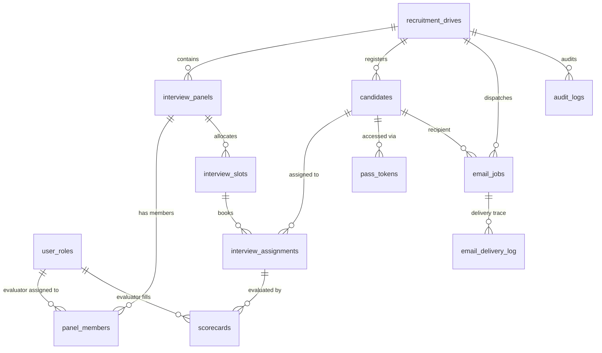

# Rotaract RecruitX — Database Architecture & Relational Model

This document outlines the relational schema, constraints, security policies, and migration instructions for the **Rotaract RecruitX** platform on Supabase PostgreSQL.

---

## 1. Entity-Relationship Overview



---

## 2. Relational Tables & Constraints (11 Operational Tables)

| # | Table | Purpose | Primary Key | Key Constraints & Uniqueness |
|---|---|---|---|---|
| 1 | `user_roles` | Server-enforced role assignments (`admin`, `interviewer`). | `id` (references `auth.users(id)`) | Unique per user; no public self-registration. |
| 2 | `recruitment_drives` | Recruitment drive batches with start/end dates and targets. | `id` (UUID) | Check constraints on date ranges and status. |
| 3 | `interview_panels` | Parallel interview rooms (e.g. Panel 1 Tech, Panel 2 Editorial). | `id` (UUID) | `unique (drive_id, name)` |
| 4 | `panel_members` | M:N mapping of interviewers to specific panels. | `id` (UUID) | `unique (panel_id, user_id)` |
| 5 | `interview_slots` | Discrete time intervals (default 15m) allocated per panel. | `id` (UUID) | `check (ends_at > starts_at)` |
| 6 | `candidates` | Student records with institutional enrollment numbers. | `id` (UUID) | `unique (drive_id, enrollment_no)`. Enrollment is NOT used as an auth credential. |
| 7 | `interview_assignments`| Mapping of a candidate to a specific panel slot. | `id` (UUID) | `unique (candidate_id, drive_id)` (1 slot per drive) & `unique (slot_id)` (anti-double booking). |
| 8 | `pass_tokens` | Candidate pass records storing SHA-256 hashes of unguessable random tokens. | `id` (UUID) | `unique (token_hash)`, `unique (candidate_id)`. Raw token is never stored in DB. |
| 9 | `scorecards` | Evaluator assessments across 5 rubric dimensions (1–5 scale). | `id` (UUID) | `unique (assignment_id, interviewer_id)` (one assessment per evaluator per candidate). |
| 10 | `email_jobs` | Idempotent background email delivery queue. | `id` (UUID) | `unique (idempotency_key)`. Retry limit of 3 with exponential backoff. |
| 11 | `email_delivery_log` | Provider response audit log for sent/failed emails. | `id` (UUID) | References `email_jobs(id)`. Sanitized errors only. |
| 12 | `app_settings` | Global and drive-specific key-value configurations. | `key` (Text) | Primary key is config key name. |
| 13 | `audit_logs` | Immutable audit trail of administrative events. | `id` (UUID) | No passwords, secrets, or raw pass tokens recorded. |

---

## 3. Row-Level Security (RLS) & Access Policy Matrix

| Table | Anonymous (`anon`) | Authenticated Evaluator (`interviewer`) | Authenticated Administrator (`admin`) |
|---|---|---|---|
| `recruitment_drives` | **Denied** | SELECT (active / completed drives) | Full CRUD |
| `interview_panels` | **Denied** | SELECT (assigned panels only) | Full CRUD |
| `panel_members` | **Denied** | SELECT (peer members of assigned panels) | Full CRUD |
| `interview_slots` | **Denied** | SELECT (slots of assigned panels only) | Full CRUD |
| `candidates` | **Denied** | SELECT (only candidates assigned to their panel) | Full CRUD |
| `interview_assignments` | **Denied** | SELECT (assignments in their panels) | Full CRUD |
| `pass_tokens` | **Denied (Direct table query)**; lookup allowed only via `get_candidate_pass_by_hash(p_token_hash)` | **Denied** | Full CRUD |
| `scorecards` | **Denied** | SELECT / INSERT / UPDATE (only scorecards they authored for assigned candidates) | Full SELECT / Audit |
| `email_jobs` | **Denied** | **Denied** | Full CRUD |
| `email_delivery_log` | **Denied** | **Denied** | Full SELECT |
| `app_settings` | **Denied** | **Denied** | Full CRUD |
| `audit_logs` | **Denied** | **Denied** | Full CRUD |

---

## 4. Setup Instructions for Fresh Supabase Project

To apply these migrations to a fresh Supabase project:

1. **Option A: Using Supabase CLI (Recommended)**
   ```bash
   supabase db reset
   # Or link and push to your remote project:
   supabase link --project-ref your-project-id
   supabase db push
   ```

2. **Option B: Using Supabase Dashboard SQL Editor**
   Run the migration files in numeric order:
   - Run `supabase/migrations/20261015000001_auth_roles.sql`
   - Run `supabase/migrations/20261015000002_core_schema.sql`
   - Run `supabase/migrations/20261015000003_rls_policies.sql`
   - *(Optional for development)* Run `supabase/seed.sql` to load demo candidates and panels.

3. **Running RLS Tests (pgTAP)**
   In the Supabase SQL editor or via CLI test runner:
   ```sql
   -- Run contents of supabase/tests/rls_tests.sql
   ```
